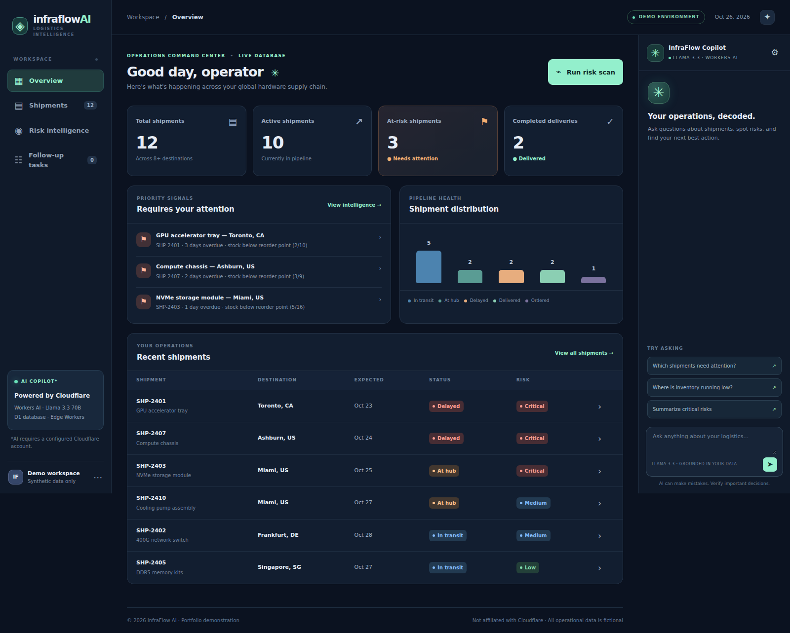
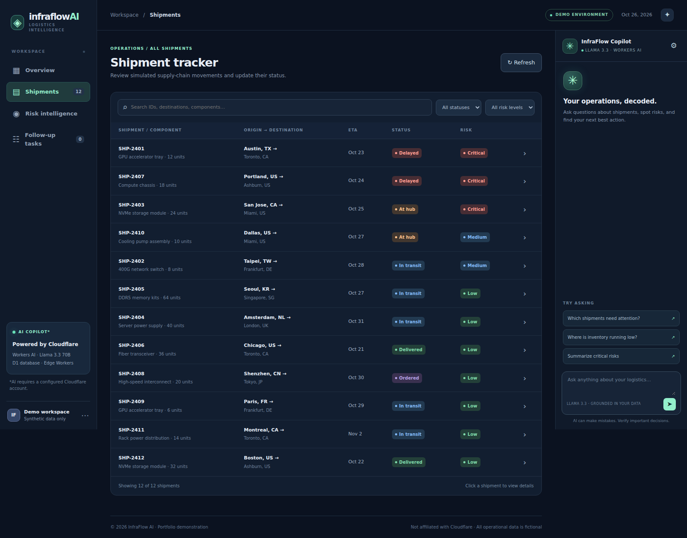
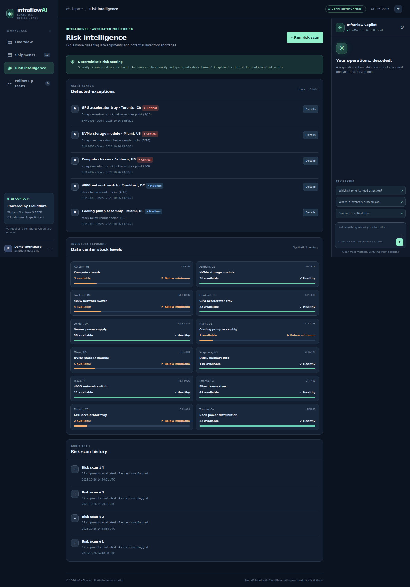
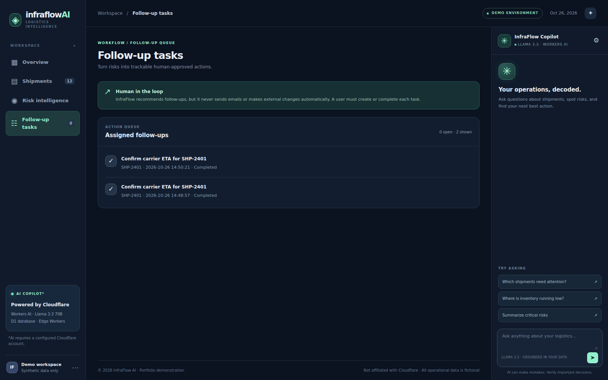

# Local application screenshots

Captured from the actual application served by local Wrangler on 2026-10-26, using synthetic D1 records. No image generation or mocked dashboard data was used. No live inference requests were made for these screenshots. The Copilot is shown in its idle state; these are not screenshots of a hosted deployment.

## Operations overview



## Shipment tracker



## Risk intelligence



## Follow-up tasks



## Reproduce

With the initialized local development server running at `http://127.0.0.1:8787`:

```bash
node scripts/capture-screenshots.mjs
```

The script may record an initial risk scan if no scan exists. It blocks chat POST requests and captures the current local data without resetting it.
